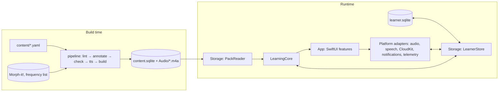

# 02 · Architecture

## Repository layout (target)

```
italiano/
├─ CLAUDE.md, README.md, PROGRESS.md, Makefile
├─ App/                         Xcode project: Italiano.xcodeproj
│  ├─ Config/                   xcconfig files (Base, Debug, Release, Study, Review; Secrets.xcconfig is gitignored)
│  │                            and entitlements (Italiano.entitlements, Italiano-NoCloud.entitlements)
│  ├─ Italiano/                 app target sources (SwiftUI), one multiplatform target
│  │  ├─ AppMain/               @main, scenes, dependency container, app config
│  │  ├─ DesignSystem/          tokens, fonts, components, Mascot
│  │  ├─ Features/              Onboarding, Today, Course, Unit, LessonPlayer, Steps/*, Review,
│  │  │                         Checks, Words, Settings, Debug
│  │  ├─ Platform/              AudioPlayer, SpeechService, CloudSync, Notifications, Telemetry
│  │  └─ Resources/             Fonts, Assets.xcassets (mascot), Content/ (content.sqlite + Audio/)
│  ├─ ItalianoTests/            Swift Testing: view models, snapshot tests
│  └─ ItalianoUITests/          XCUITest flows (also used for Mac screenshots)
├─ Packages/
│  ├─ LearningCore/             pure Swift, Foundation only; Linux-tested
│  └─ Storage/                  GRDB: content pack reader, learner database, replay
├─ pipeline/                    Python 3.12 package `itcontent`, CLI `content`
├─ content/                     YAML course sources (see docs/03)
├─ reviews/                     the content lead's review files (inbox/, never edited) and per-unit ledgers (docs/04)
├─ schemas/                     content-pack.sql (normative) and JSON Schemas for YAML
├─ fixtures/                    fsrs/, grading/, packs/ (tiny test packs), replay/
├─ design/                      tokens.json, fonts, mascot SVGs, reference screens, canvas source
├─ docs/                        these specs
└─ .claude/, .github/, .mcp.json
```

Generated, not committed: `build/` (reports, review pages, mock TTS renders in `build/tts-mock-cache/`, encoded audio in `build/audio/`), DerivedData, and the bundled pack (`App/Italiano/Resources/Content/content.sqlite` and `Content/Audio/*.m4a`), which `make pack` (and `make bootstrap`) builds deterministically from `content/` and the TTS cache. Committed through Git LFS: only the renders in `content-build/tts-cache/` (`*.flac`: rendered speech, which costs money to regenerate); their metadata (`*.json`: voice, SSML, word boundaries) is plain Git (`docs/04` § Audio). The Xcode build never runs Python; the Makefile's app targets build the pack first when it is missing, and a GUI build without it shows the pack error screen with the fix (`make pack`).

## Modules and dependency rules



| Module | May import | Must not import | Contains |
|---|---|---|---|
| `LearningCore` | Foundation | GRDB, SwiftUI, UIKit, AppKit, AVFoundation, Speech, CloudKit, FoundationModels, os | Value types for content and events; FSRS-6; grading and normalisation; feedback state machine; rating policy; eligibility; planner and session builder; check scoring; placement; replay reducer; sync merge rules; `Clock`, `UUIDSource` and RNG protocols |
| `Storage` | LearningCore, GRDB, os (`Logger` only) | SwiftUI, UIKit, AppKit, CloudKit | `PackReader` (read-only, decodes payload JSON into LearningCore types); `LearnerStore` (migrations, event append, derived tables, replay driver, settings, sync and telemetry bookkeeping tables) |
| `App` | everything above, Apple frameworks | — | Views, `@Observable` view models, platform adapters, the CKSyncEngine delegate, dependency container |
| `pipeline` | ruamel.yaml, jsonschema, pydantic, typer, requests, pytest, ruff | non-commercial data or models | Lint, annotation, checks 1–5, TTS, pack build, review pages and review import, approval, reports |

`scripts/check-core-imports.sh` enforces the LearningCore rule (it also catches `@testable import`, `import struct …` and `#if canImport`); CI and the Stop hook run it.

### LearningCore (suggested files)

```
Sources/LearningCore/
  Model/        IDs.swift (ItemID, ExerciseID… as typed wrappers), Skill.swift, Status.swift,
                ContentTypes.swift (Unit, Lesson, Step, Text, Token, Exercise + payloads), Settings.swift
  Events/       Event.swift (envelope + typed payloads), EventCodec.swift
  FSRS/         FSRS6.swift, Rating.swift, MemoryState.swift
  Grading/      Normalizer.swift, AnswerPattern.swift (parser + expansion), TypedAnswerGrader.swift,
                ChoiceGrader.swift, OrderGrader.swift, DictationGrader.swift, TranscriptMatcher.swift,
                ContentPointMatcher.swift, EnglishAnswerGrader.swift, ItalianNumbers.swift
  Feedback/     FeedbackMachine.swift (attempt 1 → hint → attempt 2 → answer + rule)
  Learner/      RatingPolicy.swift, Replay.swift (pure reducer: events → LearnerState), Eligibility.swift,
                Progress.swift (words known, can-dos, weekly goal)
  Planning/     Planner.swift (Today), ReviewSessionBuilder.swift, CardSelector.swift, Interleaver.swift
  Assessment/   CheckScoring.swift, Placement.swift
  Sync/         MergeRules.swift (event dedupe, settings LWW), RecordMapping.swift (CloudKit-agnostic)
  Support/      Clock.swift, UUIDSource.swift, SeededRNG.swift (SplitMix64), Logger protocol
```

Everything time-dependent takes a `Clock`; everything random takes a seeded RNG. Tests never call `Date()` or `UUID()` directly.

### Storage

- `PackReader` opens the bundled `content.sqlite` with a GRDB **`DatabaseQueue`** and `Configuration.readonly = true` (never `DatabasePool`: the bundle is read-only and the pack is built with `journal_mode=DELETE`, so WAL can't be used). It checks `meta.schema_version` (must equal the app's) and exposes typed queries: unit list, lesson with steps, text with lines and tokens, exercises by ID or by target, item lookup, grammar notes with their points, characters, can-dos, assessments.
  - **Opening** checks, in this order: `meta.schema_version` (`PackError.schemaMismatch`, the pack-mismatch screen), the required meta keys (`docs/04` § Pack build), every table of `schemas/content-pack.sql`, and that every query prepares against the tables; anything else is `PackError.notAContentPack` (or `fileMissing`), the pack error screen. A pack that doesn't fit fails at launch, not on some later screen.
  - **Queries** are `async` (they run on GRDB's queue, never the caller's actor) and return Sendable values. JSON columns decode into LearningCore's payload types and are checked against their row (a payload whose `id`, `format`, `role`, `unitId`, `stepId`, `score` or step `kind` contradicts its columns is `PackError.malformedRow`).
  - **Loaded once and kept** (the pack never changes while the app runs): `contentIndex()` (LearningCore's `ContentIndex`; exercise lists, checks, placement blocks and final sections come from the step and assessment payloads), `knownForms()` (the graders' `forms`), `audioCatalog()` (every audio file and text timeline, for synchronous audio lookups) and `searchIndex()` (the Words screen).
  - `verify()` decodes every JSON column and checks that every ID a payload names exists; the Storage tests run it over the test pack and `fixtures/packs/mini.sqlite`.
- `LearnerStore` owns `learner.sqlite` in Application Support (`Italiano/learner.sqlite`). It uses `DatabasePool` (WAL) and GRDB migrations (`v1`, `v2`…; never edit a shipped migration). Reference DDL is in `docs/03` § Learner database.
- Event appends and derived-state updates for that event happen in **one transaction**, with the `sync_pending` row of a local event (`append`) or without one for synced events (`insertRemote`, which ignores IDs it already has). A failed transaction changes nothing, on disk or in memory.
- The store keeps the current `LearnerState` in memory: `state` and `settings` are synchronous snapshots of the last commit, and `states()` / `settingsUpdates()` are `AsyncStream`s that yield after every commit. Writes run on GRDB's serial writer queue; `enqueueAppend(_:)` lets a synchronous caller (the exercise sink) append without waiting, in call order.
- Replay: `rebuildAll()` runs the LearningCore reducer over all events ordered by `(at, id)`, streamed from the table, and rewrites the derived tables and the checkpoint. Appends are the incremental path (`Replay.applyIncremental(to:)`); when any new event sorts before the last applied one, the same transaction runs the full rebuild instead (`docs/05` § Replay). How the state is persisted: `docs/03` § Derived state.
- Recovery (task M3.9): opening or migrating an unusable file throws `StorageError.corrupt`; `LearnerStore.openRecovering(…)` moves it aside (`learner-<UTC time>.corrupt.sqlite`, with its `-wal` and `-shm`) and opens a fresh database, and `moveAside(_:as: .archive, …)` is the same primitive for the account switch (`docs/08`).

### App

- One `WindowGroup` scene. On macOS, also a `Settings` scene with the same settings view, and the Mac menus in `docs/07` § Navigation.
- Navigation: `TabView` with `.tabViewStyle(.sidebarAdaptable)` and tabs Today, Course, Words, Settings: a tab bar on iPhone, adaptable on iPad, a sidebar on Mac. The lesson player is presented full-screen: `fullScreenCover` on iOS and iPadOS; on macOS (which has no full-screen cover) the window's content switches to the player, with Esc and a close button to leave.
- A dependency container (`AppDependencies`, injected via `@Environment`) holds `PackReader`, `LearnerStore`, `Planner`, `AudioPlaying`, `SpeechRecognizing`, `SyncControlling`, `TelemetryUploading`, `Clock`, `NotificationScheduling` and `AppConfig`. Previews and tests use fakes.
- View models are `@MainActor @Observable`. Long work (replay, pack queries) runs off the main actor in `Storage`.
- Platform adapters sit behind protocols so the Simulator, previews and tests work without a microphone, speech assets or iCloud.

| Protocol | Real implementation | Fake |
|---|---|---|
| `AudioPlaying` | AVPlayer, time observer at 30 ms, rate with time-domain pitch | scripted timeline |
| `SpeechRecognizing` | SpeechAnalyzer + SpeechTranscriber (it-IT); DictationTranscriber fallback | returns scripted transcripts; Debug menu "type to simulate speech" |
| `SyncControlling` | `SyncDriver` over `CloudSync`, the CKSyncEngine delegate (`docs/08`); created only when `ITA_SYNC_ENABLED` and `ITA_ICLOUD_ENTITLEMENT` are YES | `DisabledSync` ("Sync off in this build", also for previews); the tests run `SyncDriver` against a fake engine and in-memory private databases, two devices at a time |
| `TelemetryUploading` | URLSession batch upload (`docs/12`) | records requests |
| `NotificationScheduling` | UNUserNotificationCenter | records schedules |
| `WritingHintProviding` (optional) | FoundationModels, behind availability and a flag | none |

### App configuration

`AppConfig` reads values from Info.plist keys set by xcconfig files:

| Key | Debug | Release | Study (TestFlight) | Review (TestFlight, content lead) |
|---|---|---|---|---|
| `ITA_STUDY_BUILD` | NO | NO | YES (shows the consent screen, hides LLM hints) | NO |
| `ITA_TELEMETRY_URL` | local mock URL | empty | study endpoint | empty |
| `ITA_DEBUG_MENU` | YES | NO | NO | NO |
| `ITA_LLM_HINTS` | YES | NO | NO | NO |
| `ITA_SYNC_ENABLED` | NO (YES in the owner's signed config) | NO until M7.5, then YES | NO until M7.5, then YES | NO |
| `ITA_ICLOUD_ENTITLEMENT` | NO (YES in the owner's Signing.xcconfig, with `CODE_SIGN_ENTITLEMENTS = Config/Italiano.entitlements`) | as Debug | as Debug | as Debug |
| `ITA_REVIEW_MODE` | YES | NO | NO | YES (review mode, `docs/06`) |
| `ITA_REVIEW_URL` | local mock URL | empty | empty | review endpoint (`docs/12`) |

Release and Study archives bundle the release pack (approved content only, `make archive`); Review archives bundle the dev pack, drafts included, and go only to the internal TestFlight group of the content lead.

Tokens are not committed: `Study.xcconfig` and `Review.xcconfig` do `#include? "Secrets.xcconfig"`, a gitignored file the owner creates with `ITA_STUDY_TOKEN = …` and `ITA_REVIEW_TOKEN = …`.

The Debug menu (Settings → Debug, debug builds only) offers: clock offset (± days), jump to unit (marks earlier items introduced via a placement-style event), rebuild state from events, export the learner DB, simulate speech by typing, show eligibility for the current screen, show draft markers, and reset local data. The launch argument `-ITAJumpToUnit u02` does the same jump at launch, for UI tests and screenshots.

### Project, signing and entitlements (ADR-19)

- **The owner creates the Xcode project once** (M0.2) in Xcode 27 from the Multiplatform App template, with test targets, synchronized (folder-based) groups, the local packages `Packages/LearningCore` and `Packages/Storage` linked, swift-snapshot-testing added to the test target, and the shared scheme `Italiano` committed. Agents never hand-edit `project.pbxproj`: new source files appear through the synchronized folders, and build settings live in `App/Config/*.xcconfig`, which agents may edit.
- **Agents and CI build without a team:** `xcodebuild … CODE_SIGNING_ALLOWED=NO` for builds and simulator tests. macOS test runs that must launch a signed runner use ad-hoc "Sign to Run Locally" (`CODE_SIGN_IDENTITY = -`, no `DEVELOPMENT_TEAM`) with `App/Config/Italiano-NoCloud.entitlements`, which holds no restricted entitlements. The macOS sandbox capabilities (sandbox, microphone, network client, user-selected files) are macOS-only build settings in `Base.xcconfig` (`ENABLE_APP_SANDBOX`, `ENABLE_RESOURCE_ACCESS_AUDIO_INPUT`, `ENABLE_OUTGOING_NETWORK_CONNECTIONS`, `ENABLE_USER_SELECTED_FILES`), so no macOS-only key reaches an iOS signature. Never sign with a team: CloudKit containers can't be deleted, so `iCloud.com.j23n.italian` must be created only by the owner's first signed CloudKit build (ADR-18, Q10).
- **The owner's signed builds** use `Italiano.entitlements`: iCloud (CloudKit, container `iCloud.com.j23n.italian`), Push Notifications for CloudKit (`aps-environment`), Background Modes → Remote notifications (iOS). On macOS the app is sandboxed, and also needs the microphone (`com.apple.security.device.audio-input`; without it speech silently fails), network client (CloudKit, the study endpoint) and user-selected read-write files (export of the learner database and the examiner zip); these come from the build settings above, not from the entitlements file.
- `CKContainer(identifier:)` crashes when the entitlement is missing, so `CloudSync` is created only when `ITA_SYNC_ENABLED` is YES **and** the entitlement is present; otherwise `DisabledSync` runs and Settings shows "Sync off in this build". iOS has no public API for an app to read its own entitlements, so the build says so: the owner's Signing.xcconfig sets `ITA_ICLOUD_ENTITLEMENT = YES` in the same place it points `CODE_SIGN_ENTITLEMENTS` at `Italiano.entitlements` (`AppConfig.syncAllowed`).

## Data flow at runtime

1. Launch: open the pack and the learner DB. If the derived state is missing, `derived_version` changed or the pack's `content_hash` changed, run `rebuildAll()`; otherwise load the checkpoint and replay the few events after it. Then start sync (if enabled).
2. The learner acts (answers, taps a gloss, finishes a step). The view model asks LearningCore to grade and returns feedback; Storage appends the event and updates derived state in one transaction; sync is notified that a record is pending.
3. Remote events arrive. Storage inserts them, ignoring duplicate IDs, and applies them (or rebuilds when one sorts before the last applied event); the UI observes the store's state stream (`LearnerStore.states()`) and refreshes.
4. The Today screen asks `Planner` for due reviews, the next lesson step and weekly progress.

## Performance budgets

| What | Budget | Measured on |
|---|---|---|
| Cold launch to Today | < 1.0 s | oldest supported iPhone in the test set |
| Grade and show feedback after Check | < 50 ms | iPhone |
| Next exercise appears | < 100 ms | iPhone |
| Full replay of 50,000 events | < 1.5 s | iPhone, release build |
| Story audio start after tap | < 150 ms | iPhone |
| Pack size (SQLite, no audio) | < 15 MB | — |
| Audio | ≤ 150 MB total (ADR-17) | — |
| App memory during a lesson | < 150 MB | iPhone |

## Dependencies (pin exact versions in M0; record them in PROGRESS.md)

| Dependency | Version (Oct 2026) | Where | Licence |
|---|---|---|---|
| GRDB.swift | 7.11.1 | Storage | MIT |
| swift-snapshot-testing | 1.19.6 | App tests only | MIT |
| MobileBuildMCP (formerly XcodeBuildMCP) | 2.7.1 | agent tooling (`.mcp.json`) | MIT |
| Python | 3.12+ (managed with `uv`) | pipeline | PSF |
| ruamel.yaml (YAML 1.2), jsonschema, pydantic 2, typer, requests, pytest, ruff; playwright (dev only, review-page test) | latest at M0 | pipeline | permissive |
| ffmpeg | latest (6.1 tested) | pipeline (FLAC render cache, AAC encoding; the station effect is pure Python) | LGPL build is fine for a CLI tool we don't ship |
| Git LFS | latest | repo | MIT |

No other Swift dependencies without a proposal in `docs/13`.

## Logging and errors

- App and Storage: `os.Logger` with subsystem `com.j23n.italian` and one category per feature. Never log learner free text.
- LearningCore takes a tiny `CoreLogger` protocol (no-op by default).
- User-facing errors (task M3.9):
  - content-pack schema mismatch → blocking error screen ("Please update the app"; `error.packMismatch`);
  - learner DB corruption (open or migration fails) → move the file aside as a backup, create a fresh DB, let sync download the events again, rebuild, and tell the learner in one sentence;
  - sync problems → only a status line in Settings, never a modal.
