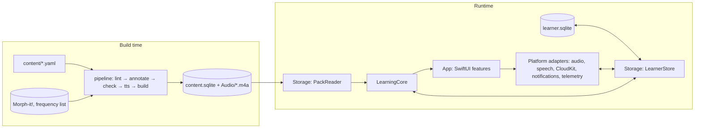

# 02 · Architecture

## Repository layout (target)

```
italiano/
├─ CLAUDE.md, README.md, PROGRESS.md, Makefile
├─ project.yml                  → Italiano.xcodeproj (XcodeGen, `make project` or `xcodegen`; the project is gitignored)
├─ Signing.xcconfig             the owner's team and signed settings (gitignored; `make signing TEAM=…`)
├─ App/
│  ├─ Config/                   xcconfig files (Base, Debug, Release, Study, Review; Secrets-Study and Secrets-Review are gitignored)
│  │                            and entitlements (Italiano.entitlements, Italiano-NoCloud.entitlements)
│  ├─ Italiano/                 app target sources (SwiftUI), one multiplatform target
│  │  ├─ AppMain/               @main, scenes, dependency container, app config
│  │  ├─ DesignSystem/          tokens, fonts, components, Mascot
│  │  ├─ Features/              Onboarding, Today, Course, Unit, LessonPlayer, Steps/*, Review,
│  │  │                         Checks, Placement, FinalCheck (incl. the examiner export's zip writer),
│  │  │                         Words, Settings, Debug
│  │  ├─ Platform/              AudioPlayer, SpeechService, CloudSync, Notifications, Telemetry, Sharing
│  │  └─ Resources/             Fonts, Assets.xcassets (mascot), Content/ (content.sqlite + Audio/)
│  ├─ ItalianoTests/            Swift Testing: view models, snapshot tests
│  └─ ItalianoUITests/          XCUITest flows (also used for Mac screenshots)
├─ Packages/
│  ├─ LearningCore/             pure Swift, Foundation only; Linux-tested
│  └─ Storage/                  GRDB: content pack reader, learner database, replay
├─ pipeline/                    Python 3.12 package `itcontent`, CLI `content`
├─ content/                     YAML course sources (see docs/03)
├─ reviews/                     the content lead's review files (inbox/, never edited) and per-unit ledgers (docs/04)
├─ schemas/                     content-pack.sql (normative) and JSON Schemas for YAML
├─ fixtures/                    fsrs/, grading/, packs/ (tiny test packs), replay/, export/
├─ design/                      tokens.json, fonts, mascot SVGs, reference screens, canvas source
├─ docs/                        these specs
└─ .claude/, .github/, .mcp.json
```

Generated, not committed: `build/` (reports, review pages, mock TTS renders in `build/tts-mock-cache/`, encoded audio in `build/audio/`), DerivedData, and the bundled pack (`App/Italiano/Resources/Content/content.sqlite` and `Content/Audio/*.m4a`), which `make pack` (and `make bootstrap`) builds deterministically from `content/` and the TTS cache. Committed through Git LFS: only the renders in `content-build/tts-cache/` (`*.flac`: rendered speech, which costs money to regenerate); their metadata (`*.json`: voice, SSML, word boundaries) is plain Git (`docs/04` § Audio). The Xcode build never runs Python; the Makefile's app targets build the pack first when it is missing, and a GUI build without it shows the pack error screen with the fix (`make pack`).

## Modules and dependency rules



| Module | May import | Must not import | Contains |
|---|---|---|---|
| `LearningCore` | Foundation | GRDB, SwiftUI, UIKit, AppKit, AVFoundation, Speech, CloudKit, FoundationModels, os | Value types for content and events; FSRS-6; grading and normalisation; feedback state machine; rating policy; eligibility; planner and session builder; check scoring; placement; replay reducer; sync merge rules; `Clock`, `UUIDSource` and RNG protocols |
| `Storage` | LearningCore, GRDB, os (`Logger` only) | SwiftUI, UIKit, AppKit, CloudKit | `PackReader` (read-only, decodes payload JSON into LearningCore types); `LearnerStore` (migrations, event append, derived tables, replay driver, settings, sync and telemetry bookkeeping tables) |
| `App` | everything above, Apple frameworks | — | Views, `@Observable` view models, platform adapters, the CKSyncEngine delegate, dependency container |
| `pipeline` | ruamel.yaml, jsonschema, pydantic, typer, requests, pytest, ruff | non-commercial data or models | Lint, annotation, checks 1–5, TTS, pack build, review pages and review import, approval, reports |

`scripts/check-core-imports.sh` enforces the LearningCore rule (it also catches `@testable import`, `import struct …` and `#if canImport`); CI runs it (`make lint-guards`).

### LearningCore (suggested files)

```
Sources/LearningCore/
  Model/        IDs.swift (ItemID, ExerciseID… as typed wrappers), Skill.swift, Status.swift,
                ContentTypes.swift (Unit, Lesson, Step, Text, Token, Exercise + payloads), Settings.swift
  Events/       Event.swift (envelope + typed payloads), EventCodec.swift
  FSRS/         FSRS6.swift, Rating.swift, MemoryState.swift
  Grading/      Normalizer.swift, AnswerPattern.swift (parser + expansion), TypedAnswerGrader.swift,
                ChoiceGrader.swift, OrderGrader.swift, DictationGrader.swift, TranscriptMatcher.swift,
                ContentPointMatcher.swift, EnglishAnswerGrader.swift, ItalianNumbers.swift,
                LetterNames.swift (spoken spelling: the pack's letter names for single letters in transcripts, and
                the names that are never an ordinary word, `neverWords`), SpelledAnswers.swift (`SpellingName`, a
                pattern's spelling from the pack; `LetterReader`, spelled runs read letter for letter, CL40, and a
                response's real spellings for spell points, CL41), KnownForms.swift (the pack's forms table: writing
                suggestions, `elisions` and `elisionReadings`, an elided form read both ways in speech, CL31)
  Feedback/     FeedbackMachine.swift (attempt 1 → hint → attempt 2 → answer + rule)
  Learner/      RatingPolicy.swift, Replay.swift (pure reducer: events → LearnerState), Eligibility.swift,
                Progress.swift (words known, can-dos, weekly goal)
  Planning/     Planner.swift (Today), ReviewSessionBuilder.swift, CardSelector.swift, Interleaver.swift
  Assessment/   CheckScoring.swift, Placement.swift, PlacementSession.swift (one sitting of the blocks),
                FinalCheck.swift (availability, runnable, speech-only sections)
  Sync/         MergeRules.swift (event dedupe, settings LWW), RecordMapping.swift (CloudKit-agnostic)
  Support/      Clock.swift, UUIDSource.swift, SeededRNG.swift (SplitMix64), Logger protocol
```

Everything time-dependent takes a `Clock`; everything random takes a seeded RNG. Tests never call `Date()` or `UUID()` directly.

### Storage

- `PackReader` opens the bundled `content.sqlite` with a GRDB **`DatabaseQueue`** and `Configuration.readonly = true` (never `DatabasePool`: the bundle is read-only and the pack is built with `journal_mode=DELETE`, so WAL can't be used). It checks `meta.schema_version` (must equal the app's) and exposes typed queries: unit list, lesson with steps, text with lines and tokens, exercises by ID or by target, item lookup, letter names (`letterNames()`, spoken spelling), grammar notes with their points, characters, can-dos, assessments.
  - **Opening** checks, in this order: `meta.schema_version` (`PackError.schemaMismatch`, the pack-mismatch screen), the required meta keys (`docs/04` § Pack build), every table of `schemas/content-pack.sql`, and that every query prepares against the tables; anything else is `PackError.notAContentPack` (or `fileMissing`), the pack error screen. A pack that doesn't fit fails at launch, not on some later screen.
  - **Queries** are `async` (they run on GRDB's queue, never the caller's actor) and return Sendable values. JSON columns decode into LearningCore's payload types and are checked against their row (a payload whose `id`, `format`, `role`, `unitId`, `stepId`, `score` or step `kind` contradicts its columns is `PackError.malformedRow`).
  - **Loaded once and kept** (the pack never changes while the app runs): `contentIndex()` (LearningCore's `ContentIndex`; exercise lists, checks, placement blocks and final sections come from the step and assessment payloads), `knownForms()` (the graders' `forms`), `audioCatalog()` (every audio file and text timeline, for synchronous audio lookups) and `searchIndex()` (the Words screen).
  - `verify()` decodes every JSON column and checks that every ID a payload names exists; the Storage tests run it over the test pack and `fixtures/packs/mini.sqlite`.
- `LearnerStore` owns `learner.sqlite` in Application Support (`Italiano/learner.sqlite`). It uses `DatabasePool` (WAL) and GRDB migrations (`v1`, `v2`…; never edit a shipped migration). Reference DDL is in `docs/03` § Learner database.
- Event appends and derived-state updates for that event happen in **one transaction**, with the `sync_pending` row of a local event (`append`) or without one for synced events (`insertRemote`, which ignores IDs it already has). A failed transaction changes nothing, on disk or in memory.
- The store keeps the current `LearnerState` in memory: `state` and `settings` are synchronous snapshots of the last commit, and `states()` / `settingsUpdates()` are `AsyncStream`s that yield after every commit. Writes run on GRDB's serial writer queue; `enqueueAppend(_:)` lets a synchronous caller (the exercise sink) append without waiting, in call order.
- Replay: `rebuildAll()` runs the LearningCore reducer over all events ordered by `(at, id)`, streamed from the table, and rewrites the derived tables and the checkpoint. Appends are the incremental path (`Replay.applyIncremental(to:)`); when any new event sorts before the last applied one, the same transaction runs the full rebuild instead (`docs/05` § Replay). How the state is persisted: `docs/03` § Derived state.
- Recovery (task M3.9): opening or migrating an unusable file throws `StorageError.corrupt`; `LearnerStore.openRecovering(…)` moves it aside (`learner-<UTC time>.corrupt.sqlite`, with its `-wal` and `-shm`) and opens a fresh database, and `moveAside(_:as: .archive, …)` is the same primitive for the account switch (`docs/08`).

### App

- One `WindowGroup` scene. On macOS, also a `Settings` scene with the same settings view, and the Mac menus in `docs/07` § Navigation.
- Navigation: `TabView` with `.tabViewStyle(.sidebarAdaptable)` and tabs Today, Course, Words, Settings: a tab bar on iPhone, adaptable on iPad, a sidebar on Mac. The lesson player is presented full-screen: `fullScreenCover` on iOS and iPadOS; on macOS (which has no full-screen cover) the window's content switches to the player, with Esc and a close button to leave.
- A dependency container (`AppDependencies`, injected via `@Environment`) holds `PackReader`, `LearnerStore`, `Planner`, `AudioPlaying`, `SpeechRecognizing`, `SyncControlling`, `TelemetryUploading`, `Clock`, `NotificationScheduling`, `ExportSharing` and `AppConfig`. Previews and tests use fakes.
- View models are `@MainActor @Observable`. Long work (replay, pack queries) runs off the main actor in `Storage`.
- Platform adapters sit behind protocols so the Simulator, previews and tests work without a microphone, speech assets or iCloud.

| Protocol | Real implementation | Fake |
|---|---|---|
| `AudioPlaying` | AVPlayer, time observer at 30 ms, rate with time-domain pitch | scripted timeline |
| `SpeechRecognizing` | SpeechAnalyzer + SpeechTranscriber (it-IT); DictationTranscriber fallback | returns scripted transcripts; Debug menu "type to simulate speech" |
| `SyncControlling` | `SyncDriver` over `CloudSync`, the CKSyncEngine delegate (`docs/08`); created only when `ITA_SYNC_ENABLED` and `ITA_ICLOUD_ENTITLEMENT` are YES | `DisabledSync` ("Sync off in this build", also for previews); the tests run `SyncDriver` against a fake engine and in-memory private databases, two devices at a time |
| `TelemetryUploading` | URLSession batch upload (`docs/12`) | records requests |
| `NotificationScheduling` | UNUserNotificationCenter | records schedules |
| `ExportSharing` | `SystemExportSharing`: `UIActivityViewController` (its `completionWithItemsHandler`) on iOS and iPadOS, `NSSharingServicePicker` and the chosen service's delegate on macOS; reports whether the share completed (`docs/12` § Final check export) | answers a scripted outcome and keeps the shared files |
| `WritingHintProviding` (optional) | FoundationModels, behind availability and a flag | none |

### App configuration

`AppConfig` reads values from Info.plist keys set by xcconfig files:

| Key | Debug | Release | Study (TestFlight) | Review (TestFlight, content lead) |
|---|---|---|---|---|
| `ITA_STUDY_BUILD` | NO | NO | YES (shows the consent screen, hides LLM hints) | NO |
| `ITA_TELEMETRY_URL` | local mock URL | empty | study endpoint | empty |
| `ITA_DEBUG_MENU` | YES | NO | NO | NO |
| `ITA_LLM_HINTS` | YES | NO | NO | NO |
| `ITA_SYNC_ENABLED` | NO (YES in the owner's signed config) | NO until M7.5, then YES | NO until M7.5, then YES | NO |
| `ITA_ICLOUD_ENTITLEMENT` | NO (YES in the owner's Signing.xcconfig, with `CODE_SIGN_ENTITLEMENTS = App/Config/Italiano.entitlements`) | as Debug | as Debug | as Debug |
| `ITA_REVIEW_MODE` | YES | NO | NO | YES (review mode, `docs/06`) |
| `ITA_REVIEW_URL` | local mock URL | empty | empty | review endpoint (`docs/12`) |
| `FEEDBACK` (a Swift compilation condition, not a key) | set: in-app feedback to the owner's private GitHub inbox (ADR-23) | not set (FeedbackKit is linked but dormant) | not set (the same) | not set (the same) |

Release and Study archives bundle the release pack (approved content only, `make archive`); Review archives bundle the dev pack, drafts included, and go only to the internal TestFlight group of the content lead.

Tokens are not committed, and each build gets only its own: `Study.xcconfig` does `#include? "Secrets-Study.xcconfig"` (`ITA_TELEMETRY_URL`, `ITA_STUDY_TOKEN`) and `Review.xcconfig` does `#include? "Secrets-Review.xcconfig"` (`ITA_REVIEW_URL`, `ITA_REVIEW_TOKEN`), two gitignored files the owner creates. After the include each configuration clears the other build's keys, so a study participant's app never carries the review token and the content lead's never carries the study token (a test resolves both chains with all four keys in the secrets file).

The Debug menu (Settings → Debug, builds with `ITA_DEBUG_MENU` only; `DebugMenuModel`) offers:

- **clock offset** (± days): the app runs on `DebugClock`, the device clock plus whole days, so the planner, due dates and new events all move; the offset is kept for the next launch (`UserDefaults`, never synced);
- **jump to unit**: a `placementCompleted` starting at the unit (earlier units become skipped) and one `introduced` event (via `debug`) for every item of the earlier units per its status, as placement would write; nothing is written for FSRS, and only what is still missing is written, so jumping twice writes nothing;
- **rebuild state from events** (`LearnerStore.rebuildAll()`), **export the learner DB** (`LearnerStore.exportCopy(to:)`, a single-file copy through SQLite's online backup, saved with the file exporter);
- **simulate speech by typing**: `SimulatedSpeechRecognizer` wraps the real recogniser; switched on, speech counts as available and each recording asks for the transcript in a panel of the player's debug overlay;
- **show eligibility for the current screen** and **show draft markers**: the lesson and review players' debug overlay shows "DRAFT" on unapproved steps of a dev pack and an eligibility badge that opens the requirements of the step and exercise on screen;
- **reset local data**: Reset progress (`docs/08`) through the sync driver when sync runs, else `eraseProgress()`; onboarding runs again;
- **auto-answer in lessons** (task M6.3, `AutoAnswer`): the lesson, review and assessment players show a small bar with **Answer correctly** (`debug.autoAnswer`), **Answer wrongly** (`debug.autoAnswerWrong`) and **Answer and continue** (`debug.autoAdvance`). It answers through the exercise's own view model, so the graders, the feedback machine and the `attempt` events all run: a correct answer comes from the payload's model answers and correct indices and is kept only when the grader accepts it for this learner; speaking formats get the transcript the simulated recogniser would hand over. A wrong answer is one wrong attempt (the first shows the hint, the second the answer).

It also shows the last storage error. Launch arguments for UI tests and screenshots, all ignored by builds without the Debug menu:

- `-ITAJumpToUnit u02` does the same jump at launch, and first completes onboarding with its defaults if it hasn't run (so the app opens on Today, never on placement: a jump places the learner); relaunching with it writes nothing, so a half-done step resumes.
- `-ITAAutoAnswer` shows the auto-answer bar for this launch (the Debug menu's switch is kept between launches; the argument isn't).
- `-ITAFreshLearner` opens a new, empty learner database for this launch; `-ITALearner <name>` opens a throwaway one kept under that name, so a test can quit and relaunch onto the same progress. Both live in the app's temporary directory (`ItalianoUITests/<name>/learner.sqlite`), never in Application Support.
- The Debug menu's kept switches are `UserDefaults` keys, so a test pins them through the argument domain: `-ITADebugClockOffsetDays 10`, `-ITADebugShowEligibility NO`, `-ITADebugShowDraftMarkers NO`, `-ITADebugShowAutoAnswer NO`. The Debug menu, and with it every argument here, exists only when `ITA_DEBUG_MENU` is YES in a build that is neither a study build nor bundles the release pack (`AppConfig.debugMenu`, the same second guard as review mode).

Debug builds have review mode on (`ITA_REVIEW_MODE`, `docs/06`); the launch argument `-ITANoReviewMode` turns it off, and UI tests and screenshots of the learner's path pass it (with `-ITAJumpToUnit` when they start deep in the course).

### Project, signing and entitlements (ADR-19)

- **The project is generated** (ADR-19 as amended): `make project` (or `xcodegen` at the root) runs XcodeGen 2.46.0+ on `project.yml` and writes `Italiano.xcodeproj` next to it (gitignored; the Makefile's app targets regenerate it when `project.yml` or an xcconfig is newer). The spec has the multiplatform app target `Italiano` (iOS, iPadOS, macOS 26), `ItalianoTests` (hosted in the app; the packages' modules without a second copy) and `ItalianoUITests`, the local packages `Packages/LearningCore` and `Packages/Storage`, swift-snapshot-testing 1.19.6, FeedbackKit (ADR-23; pinned to a commit, linked into every configuration, used only with `FEEDBACK`), the configurations Debug, Release, Study and Review, and the shared scheme `Italiano`. Sources are synchronized folders (`Resources/Content` stays a folder in the bundle), so a new file needs no regeneration. The app target has no build settings of its own: XcodeGen's target presets are off and every setting comes from `App/Config/*.xcconfig` (the test targets use `Tests.xcconfig`). Change targets, packages or schemes in `project.yml`; nobody edits the generated project.
- **Build numbers:** the app's `CFBundleVersion` is the number of commits on `HEAD`, set as it's built by j23n/apple-ci's `build-number.sh` (`.apple-ci/`), the target's last build phase; `CURRENT_PROJECT_VERSION` is only what a build without git history keeps, and `MARKETING_VERSION` stays the version people see. The script reads `.git`, so the app target runs scripts without the sandbox. Archive from `main`: a branch's count can match one `main` gets later.
- **The owner's team** is in `Signing.xcconfig` at the root (gitignored), which `Base.xcconfig` includes last: `make signing TEAM=…` writes it, and pulls and regenerations keep it. It also holds the owner's signed settings (`CODE_SIGN_ENTITLEMENTS = App/Config/Italiano.entitlements`, `ITA_ICLOUD_ENTITLEMENT`, `ITA_SYNC_ENABLED`). It used to be `App/Config/Signing.xcconfig`; `make project` warns while that file exists.
- **Agents and CI build without a team:** `xcodebuild … CODE_SIGNING_ALLOWED=NO` for builds and simulator tests. macOS test runs that must launch a signed runner use ad-hoc "Sign to Run Locally" (`CODE_SIGN_IDENTITY = -`, no `DEVELOPMENT_TEAM`) with `App/Config/Italiano-NoCloud.entitlements`, which holds no restricted entitlements. The macOS sandbox capabilities (sandbox, microphone, network client, user-selected files) are macOS-only build settings in `Base.xcconfig` (`ENABLE_APP_SANDBOX`, `ENABLE_RESOURCE_ACCESS_AUDIO_INPUT`, `ENABLE_OUTGOING_NETWORK_CONNECTIONS`, `ENABLE_USER_SELECTED_FILES`), so no macOS-only key reaches an iOS signature. Never sign with a team: CloudKit containers can't be deleted, so `iCloud.com.j23n.italian` must be created only by the owner's first signed CloudKit build (ADR-18, Q10).
- **The owner's signed builds** use `Italiano.entitlements`: iCloud (CloudKit, container `iCloud.com.j23n.italian`), Push Notifications for CloudKit (`aps-environment`), Background Modes → Remote notifications (iOS). On macOS the app is sandboxed, and also needs the microphone (`com.apple.security.device.audio-input`; without it speech silently fails), network client (CloudKit, the study endpoint, and in Debug builds the feedback inbox, ADR-23) and user-selected read-write files (export of the learner database and the examiner zip); these come from the build settings above, not from the entitlements file.
- `CKContainer(identifier:)` crashes when the entitlement is missing, so `CloudSync` is created only when `ITA_SYNC_ENABLED` is YES **and** the entitlement is present; otherwise `DisabledSync` runs and Settings shows "Sync off in this build". iOS has no public API for an app to read its own entitlements, so the build says so: the owner's Signing.xcconfig sets `ITA_ICLOUD_ENTITLEMENT = YES` in the same place it points `CODE_SIGN_ENTITLEMENTS` at `Italiano.entitlements` (`AppConfig.syncAllowed`).

## Data flow at runtime

1. Launch: open the pack and the learner DB. If the derived state is missing, `derived_version` changed or the pack's `content_hash` changed, run `rebuildAll()`; otherwise load the checkpoint and replay the few events after it. Then start sync (if enabled).
2. The learner acts (answers, taps a gloss, finishes a step). The view model asks LearningCore to grade and returns feedback; Storage appends the event and updates derived state in one transaction; sync is notified that a record is pending.
3. Remote events arrive. Storage inserts them, ignoring duplicate IDs, and applies them (or rebuilds when one sorts before the last applied event); the UI observes the store's state stream (`LearnerStore.states()`) and refreshes.
4. The Today screen asks `Planner` for due reviews, the next lesson step and weekly progress.

## Performance budgets

| What | Budget | Measured on |
|---|---|---|
| Cold launch to Today | < 1.0 s | oldest supported iPhone in the test set |
| Grade and show feedback after Check | < 50 ms | iPhone |
| Next exercise appears | < 100 ms | iPhone |
| Full replay of 50,000 events | < 1.5 s | iPhone, release build |
| Story audio start after tap | < 150 ms | iPhone |
| Pack size (SQLite, no audio) | < 15 MB | — |
| Audio | ≤ 150 MB total (ADR-17) | — |
| App memory during a lesson | < 150 MB | iPhone |

## Dependencies (pin exact versions in M0; record them in PROGRESS.md)

| Dependency | Version (Oct 2026) | Where | Licence |
|---|---|---|---|
| GRDB.swift | 7.11.1 | Storage | MIT |
| swift-snapshot-testing | 1.19.6 | App tests only | MIT |
| FeedbackKit (j23n/feedbackkit) | a pinned commit (`project.yml`) | App, code used only in Debug builds (`FEEDBACK`, ADR-23); linked into every configuration | MIT |
| MobileBuildMCP (formerly XcodeBuildMCP) | 2.7.1 | agent tooling (`.mcp.json`) | MIT |
| Python | 3.12+ (managed with `uv`) | pipeline | PSF |
| ruamel.yaml (YAML 1.2), jsonschema, pydantic 2, typer, requests, pytest, ruff; playwright (dev only, review-page test) | latest at M0 | pipeline | permissive |
| ffmpeg | latest (6.1 tested) | pipeline (FLAC render cache, AAC encoding; the station effect is pure Python) | LGPL build is fine for a CLI tool we don't ship |
| Git LFS | latest | repo | MIT |

No other Swift dependencies without a proposal in `docs/13`.

## Logging and errors

- App and Storage: `os.Logger` with subsystem `com.j23n.italian` and one category per feature. Never log learner free text.
- LearningCore takes a tiny `CoreLogger` protocol (no-op by default).
- User-facing errors (task M3.9):
  - content-pack schema mismatch → blocking error screen ("Please update the app"; `error.packMismatch`);
  - learner DB corruption (open or migration fails) → move the file aside as a backup, create a fresh DB, let sync download the events again, rebuild, and tell the learner in one sentence; onboarding shows on the fresh DB until the learner's synced `profile.forms` comes back, which ends it without asking again;
  - sync problems → only a status line in Settings, never a modal.
