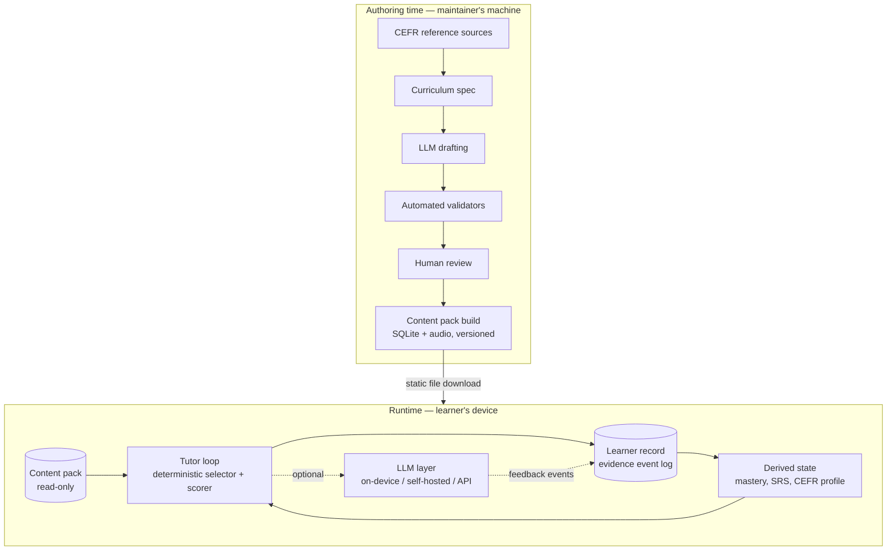

# 02 — Greenfield architecture: a CEFR-grounded, local-first learning system

Status: draft
Owner: solo
Relation to the earlier content-pack draft (removed; in git history):
its core bet — content is
authored ahead of time with LLM assistance and human curation, and lessons
are **selected, not generated** — carries over unchanged. This document
revises the surrounding assumptions: native mobile instead of web+PWA,
local-first learner data instead of a Mongo-backed server, and a first-class
offline story instead of "queue the LLM calls". It is a conceptual
architecture — how the pieces fit together — not an implementation plan.

Decisions this document assumes (made 2026-07):

- **Offline core, LLM optional.** The complete learning loop — lessons,
  drills, reading, listening, vocabulary review, progression — works with
  no network. LLM features enhance the experience when a backend is
  reachable and degrade gracefully when it is not.
- **Native mobile first** (iOS + Android). Language learners live on
  phones; native gives real offline storage, on-device speech, and the
  option of on-device models.
- **LLM-generated, human-curated content.** The LLM's heavy lifting moves
  to authoring time. Runtime consumes static, versioned packs.
- **Personal tool, local-first.** One learner per device; all learner data
  lives on the device. There are no accounts and no server that knows who
  is learning what.

---

## 1. The one-paragraph version

The system is four layers with clean seams. A **curriculum spec** per
language defines the CEFR coordinate system: grammar points, communicative
functions, vocabulary, topics, and can-do statements. **Content packs** are
large banks of concrete learning items — drills, dialogues, passages,
audio — each item tagged with coordinates in that spec, drafted by an LLM
at authoring time, validated automatically, reviewed by a human, and
shipped as versioned static bundles. The **learner model** is an on-device,
append-only log of evidence events plus state derived from it: mastery per
grammar point, function demonstrations, vocabulary scheduling, and a
per-modality CEFR estimate. The **tutor loop** is a deterministic runtime
that intersects the three — spec × pack × learner — to compose each
session. An optional **LLM layer** sits beside (not under) this loop,
adding rich feedback on free production, conversation practice, and
personalized explanation, through whichever backend the learner configures.



The load-bearing property: **the arrow between authoring and runtime
carries only content, and nothing flows back.** Personalization happens
entirely on-device, as selection over a bank large enough that selection
feels generative. That is what makes offline, privacy, and cheap content
rollout all fall out of the same design instead of fighting each other.

---

## 2. Layer 1 — The curriculum spec (the coordinate system)

The spec is the small, slow-moving, hand-curated heart of a language. It
is what makes the app *CEFR-grounded* rather than CEFR-flavored. Per
language it defines:

- **Can-do statements** — the CEFR's native unit ("Can order a meal and
  ask about dishes", A1). These are the top of the hierarchy and the
  learner-facing definition of progress. Each can-do decomposes into the
  grammar, functions, and vocabulary it requires. Derive these from the
  official Reference Level Descriptions — *Profilo della lingua italiana*
  for Italian, *Profile Deutsch* for German — as inspiration and
  completeness checklists, writing our own descriptor text (the RLDs
  themselves are copyrighted).
- **Grammar inventory** — grammar points with CEFR level, category,
  sub-skills, and a prerequisite DAG. This exists today
  (`grammar_points.yaml`) and survives largely intact.
- **Communicative function inventory** — CEFR-tagged speech acts, grouped
  by macro-category. Also exists today.
- **Vocabulary list** — frequency-ranked, CEFR-leveled lemmas
  (~1,500 through A2, ~3,500 through B1). Doubles as a *constraint*: any
  word in generated content outside the learner's level must carry an
  inline gloss, and validators enforce this.
- **Topics/scenarios** — situational packaging ("At the restaurant",
  "Finding an apartment") with the current design's *depth* idea kept:
  the same scenario revisited at increasing complexity.
- **Phonology/orthography notes** — a light inventory of pronunciation
  targets (Italian double consonants, German ich/ach sounds) so speaking
  practice has named targets too.

Everything in the spec has a **stable ID**. Content items reference spec
IDs; learner evidence references spec IDs; progress is reported against
spec IDs. The spec is the shared vocabulary of the entire system, which is
why it must be hand-curated even though everything downstream of it is
LLM-drafted.

What changes vs. today: the inventories already exist but are implicitly
cross-referenced YAML/JSON with no schema enforcement, and can-do
statements are missing entirely. The spec becomes one schema-validated
artifact per language, with can-dos as the roof over grammar + functions +
vocab rather than four parallel lists.

---

## 3. Layer 2 — Content packs (the material)

A content pack is the materialized library for a language: every drill,
dialogue, reading passage, listening script, grammar reference page,
writing prompt, and audio file, compiled into a read-only bundle the app
downloads. The schema sketches in doc 01 §4 still apply; the conceptual
points that matter here:

**Every item is a tagged evidence generator.** An item declares which
grammar points (and sub-skills), functions, vocabulary, topic, CEFR level,
and *modality* (reading / listening / writing / speaking / interaction) it
exercises, plus an evidence weight. When the learner completes it, those
tags say exactly which axes of the learner model receive evidence. This
single convention is what unifies content and progression: adding a new
activity type never requires touching the learner model, only tagging.

**Items carry their own feedback.** Because items are static, the
authoring pipeline can pre-generate what today requires a runtime LLM
call: per-item acceptable-answer lists (so "ho mangiato" vs "io ho
mangiato" is a data problem, not an AI problem), per-distractor
explanations ("*sono mangiato* — mangiare takes *avere*"), and a
mistake-explanation paragraph per item. Offline, wrong answers still get
targeted, curated feedback. The runtime LLM becomes an *upgrade* to
explanations, not the only source of them.

**Variants substitute for generation.** The fear with static content is
staleness. The answer is bank depth, which LLM drafting makes cheap:
30–50 drills per sub-skill, several passages per topic×level, dialogue
variants per scenario depth. The selector's anti-repetition window plus
weakness-weighting over a deep bank is indistinguishable, from the
learner's seat, from bespoke generation — and every item was reviewed by
a human, which bespoke generation can never promise.

**Narrative continuity is authored, not generated.** Today a per-student
LLM "storyline" threads lessons together. The static equivalent:
scenarios are authored as small branching arcs (depth 1 → 2 → 3 with
recurring characters), and the selector interpolates the learner's name
and preferences into template slots. Less magical, fully offline,
QA-able.

**Packs are the unit of rollout.** A pack has a semver version and a
manifest. Shipping new content — a new topic, a B1 tranche, a fixed typo
— is publishing a new pack version to static hosting; the app checks the
manifest and offers the download. No app-store release, no server
deployment, no migration of learner data (see §4 on ID stability). This
is the whole answer to "easy to roll out new content": content rollout is
a *file publish*.

### The authoring pipeline

```
spec cell (e.g. passato_prossimo × food × A2)
  → LLM drafts a batch of items
  → automated validators:
      schema · vocab-level constraint (gloss or reject) ·
      answer-key solvability · morphology/agreement heuristics ·
      duplicate detection · no target-language/English bleed
  → human review queue (accept / edit / reject, per item)
  → L1 speaker spot-check pass per release
  → pack build: YAML → SQLite bundle + pre-rendered audio
  → signed release on static hosting
```

The maintainer's recurring job is the review queue, not writing content.
Validators are where quality scales: every class of error the L1 reviewer
finds should, where possible, become a new automated check. The LLM can
also be used *adversarially* at authoring time — a second model pass that
tries to find a defensible alternative answer for each drill, flagging
items whose answer key is contestable.

---

## 4. Layer 3 — The learner model (the record)

All learner data lives on the device, and the canonical form is an
**append-only event log**, not a mutable profile document.

An evidence event is small and uniform:

```
{ when, item_id, pack_version, modality,
  outcome (correct / partial / incorrect / skipped),
  evidence: [ {axis: grammar, id: passato_prossimo.aux_avere, weight: 1.0},
              {axis: function, id: ordering_food, weight: 0.5},
              {axis: vocab, id: mangiare, srs_grade: 4} ],
  response (the learner's actual answer, kept locally),
  feedback_source (deterministic / pre-authored / llm) }
```

Everything else is **derived state**, recomputable by folding over the
log:

- **Grammar mastery** — the current evidence-weighted, time-decayed model
  is good and survives: productive evidence (writing/speaking) counts
  more than targeted drills, which count more than receptive
  recognition; scores decay ~0.95/day so mastery reflects the present.
- **Function demonstrations** — counts of successful productive use.
- **Vocabulary** — SM-2 (or FSRS) scheduling state per lemma, plus
  coverage against the level's vocab list.
- **Scenario/topic progress** — depth reached, per the current design.
- **Can-do status** — a can-do is *achieved* when its constituent grammar
  points are mastered, its functions demonstrated, and at least one
  application-grade task for it completed. This rolls the axes up into
  the learner-facing progress view.
- **CEFR estimate** — computed per modality, not as one number: coverage ×
  mastery against the level's inventories yields "solid A2 in reading and
  listening, A1+ in writing, limited speaking evidence". Honesty matters
  here: production skills assessed without LLM (or human) feedback get a
  confidence cap, shown as "low evidence" rather than silently inflated.

Why event-sourcing rather than the current denormalized profile document:

1. **Mastery formulas can evolve.** Change the decay rate or evidence
   weights, replay the log, done. No migration of derived numbers.
2. **Pack updates can't corrupt history.** Events reference stable item
   IDs + pack version; a deprecated item keeps a tombstone in the pack so
   old events remain interpretable.
3. **Deferred feedback slots in naturally.** A writing submission scored
   offline-deterministically today and LLM-reviewed tomorrow is just a
   second event referencing the first — the fold picks up the richer
   evidence when it arrives.
4. **Privacy features come free.** "Export my data" is the log. Encrypted
   backup is the log. Future multi-device sync is an append-only log
   merge — near-CRDT by construction — with no server ever holding
   plaintext.

---

## 5. Layer 4 — The tutor loop (the runtime)

The tutor loop is deterministic, on-device, and the only component that
touches all three layers. Each session it answers four questions:

1. **What is unlocked?** The prerequisite DAG over grammar points, phase
   gating over scenarios, and depth gating — the current curriculum
   engine's pure-function design, kept as-is conceptually.
2. **What does this learner need?** A review/new-material budget: overdue
   SRS vocabulary, grammar points whose decayed mastery has slipped
   (spaced *grammar* repetition, not just vocab — decay makes review
   scheduling automatic), weak sub-skills, and the frontier of
   not-yet-introduced material.
3. **What shape should the session be?** Lesson archetypes survive from
   the current design: *introduce* (grammar card + scaffolded drills),
   *consolidate* (mixed drills + receptive work), *apply* (scenario
   dialogue + production task). Archetype choice falls out of mastery
   state. Sessions should also honor a time budget — a 5-minute queue
   session (drills + SRS only) and a 15-minute full session are different
   selections, not different systems.
4. **Which concrete items?** Weakness-weighted sampling from the bank,
   filtered by unlock state and topic preference, excluding a
   recent-item window, biased toward the learner's chosen topics.

Scoring at this layer is deterministic: normalization + acceptable-answer
matching for closed items, checklist heuristics for open ones (length,
required structures attempted, vocabulary level). Wrong answers surface
the item's pre-authored feedback immediately. Nothing in this loop can
block on a network call.

---

## 6. The LLM layer (the optional tutor)

The LLM sits *beside* the core loop as an enhancer, never *under* it as a
dependency. Its runtime roles, in descending order of value:

1. **Free-production feedback** — rubric-based review of writing and open
   speaking: what was right, the two most important errors, a model
   answer. This is the hardest thing to fake statically and the main
   reason the layer exists.
2. **Conversation practice** — scenario-grounded dialogue with a tutor
   persona, constrained by the learner's level (vocab list + introduced
   grammar as the persona's constraint set). Online-tier feature.
3. **Personalized explanation** — "explain again, differently, knowing
   what I've gotten wrong before" as an upgrade over the pre-authored
   explanation.
4. **Remediation drafting** — when a weakness is persistent and the bank
   thin at that spot, the LLM may draft extra targeted drills *into a
   local review queue*, marked unreviewed, quarantined from the curated
   bank.

**Backends, behind one interface:** a cloud API with the learner's own
key; a self-hosted endpoint (the learner's own server — the natural home
for today's server-ful deployment mode); or an on-device small model
(3–4B quantized) on capable phones, expected to handle tier 3 acceptably
and tier 1 with visible quality caveats. Capability detection plus an
explicit learner setting; the UI labels feedback with its source.

**The degradation ladder** makes "LLM optional" concrete:

| Capability | Offline (always works) | With LLM backend |
| --- | --- | --- |
| Drills, reading, listening | Full: deterministic scoring, pre-authored feedback | Personalized follow-up explanation |
| Vocabulary SRS | Full | — |
| Writing | Captured + checklist feedback; queued | Rubric feedback, model answer (arrives when reachable) |
| Speaking (closed tasks) | On-device STT vs. expected transcript | Pronunciation + phrasing feedback |
| Speaking (open) / conversation | Recorded + queued / unavailable | Full |
| Explanations | Pre-authored per item | Personalized, dialogic |
| Progress & CEFR estimate | Full (production confidence capped) | Confidence uncapped by richer evidence |

The queue discipline matters: deferred submissions are events (§4), the
learner sees "feedback pending", and arrival of feedback is an ordinary
evidence event — no special sync machinery.

---

## 7. Platforms and what "entirely offline" means on each

**iOS + Android native** is the target, and it is the only platform pair
where "entirely offline" is honest:

- Content pack (read-only SQLite + audio) and learner log (local SQLite)
  are ordinary app storage — durable, not evictable the way browser
  storage is (the iOS-PWA eviction problem that motivated the platform
  question disappears).
- **Audio**: pre-rendered in the pack for all scripted content; on-device
  neural system TTS (AVSpeechSynthesizer / Android TTS) as the fallback
  for arbitrary text. No cloud TTS at runtime.
- **Speech recognition**: both platforms ship on-device recognition for
  Italian and German, enabling offline *closed* speaking tasks
  (read-aloud, prompted response) scored by transcript alignment.
- **On-device LLM**: feasible on recent flagships as an optional download,
  slotting into the backend interface above; never assumed.

Recommended shape (one level of concreteness, no more): a **portable core**
containing the tutor loop, learner model, and pack reader — one codebase,
e.g. Kotlin Multiplatform or Rust — with thin native UI shells per
platform. The same core embedded in a desktop or server shell later
recovers a web deployment without re-architecting; web simply isn't first
this time.

Infrastructure footprint of the whole system: **static file hosting for
packs. Nothing else is required.** A self-hosted LLM proxy is an optional
convenience, not a component of the architecture.

---

## 8. Privacy model

Local-first makes most privacy questions structural rather than
policy-based:

- No accounts, no learner-data server, no telemetry by default. The
  content server sees an anonymous pack download, nothing more.
- The only data that can leave the device is what the LLM layer sends,
  and it is: explicit (a visible, per-feature setting), minimal (the
  submission + item context + relevant weakness tags — never the full
  history), user-routed (their key, their server, or their device), and
  logged (an in-app "what left this device" ledger).
- Export and encrypted backup of the full event log are first-class,
  which is also the future path to multi-device sync (log merge via any
  dumb encrypted relay, including the learner's own server).
- Opt-in telemetry, if ever added, reports content quality signals
  (item-level error rates, flagged items) — about the *content*, not the
  learner — and even that stays off by default.

---

## 9. What survives from today, what changes

| Current design | Greenfield |
| --- | --- |
| Grammar/function/vocab/scenario inventories, CEFR-tagged | **Survives** — becomes the schema-validated curriculum spec, plus can-do statements on top |
| Prerequisite DAG, phase/depth gating, lesson archetypes | **Survives** — the tutor loop's unlock logic, already pure functions |
| Mastery model (weighted, decayed evidence) | **Survives** — becomes a fold over the event log; also drives grammar review scheduling |
| SM-2 vocab SRS | **Survives** (consider FSRS) |
| A0 static YAML vs. A1+ runtime generation split | **Gone** — one content model at every level; A0's approach wins and scales up via authoring-time LLM |
| Runtime LLM lesson generation (`planner.py`) | **Moves to authoring time** as the drafting stage of the pack pipeline |
| LLM scoring of fill-blank / error-correction / reading | **Gone** — deterministic scoring against curated acceptable answers + pre-authored per-distractor feedback |
| Per-student LLM storyline | **Replaced** by authored scenario arcs + template interpolation |
| MongoDB profile document, server-side | **Replaced** by on-device event log + derived state |
| FastAPI server as the product | **Replaced** by native apps + static pack hosting; a server survives only as an optional LLM proxy / sync relay |
| Azure TTS/STT at runtime | **Moves** to authoring time (TTS) and on-device (STT, fallback TTS) |
| Writing/speaking LLM feedback | **Survives** as the LLM layer's tier-1 role, now optional and queueable |

---

## 10. Open questions

1. **Conversation practice ambition.** It is the one genuinely
   online-tier feature. Ship v1 without it, or is it a core promise?
   (Recommendation: without; the architecture leaves a clean slot.)
2. **Can-do inventory scope.** Writing ~60–80 original descriptors per
   level band, RLD-inspired, is real curriculum work. Worth doing for
   A0–A2 up front, since it's the learner-facing progress spine.
3. **Shared-core technology** (Kotlin Multiplatform vs. Rust core vs.
   Flutter) — deliberately out of scope here, but it is the first
   concrete decision the implementation plan must make.
4. **Sync.** The event log makes it tractable, but v1 can ship with
   export/backup only. Decide whether "second device" is a v1.x promise.
5. **Existing web app's fate.** The portable core could eventually be
   wrapped for web/self-host again; until then, does the current app stay
   on life support or freeze?
